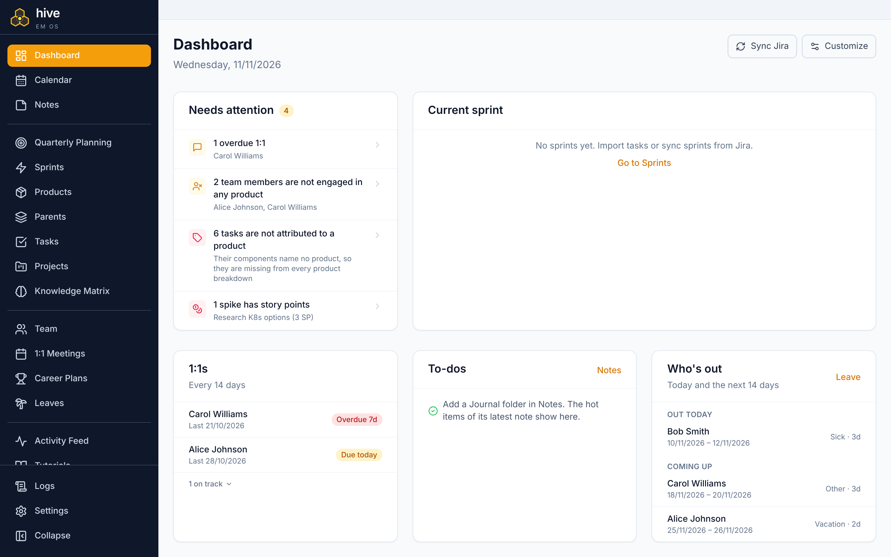
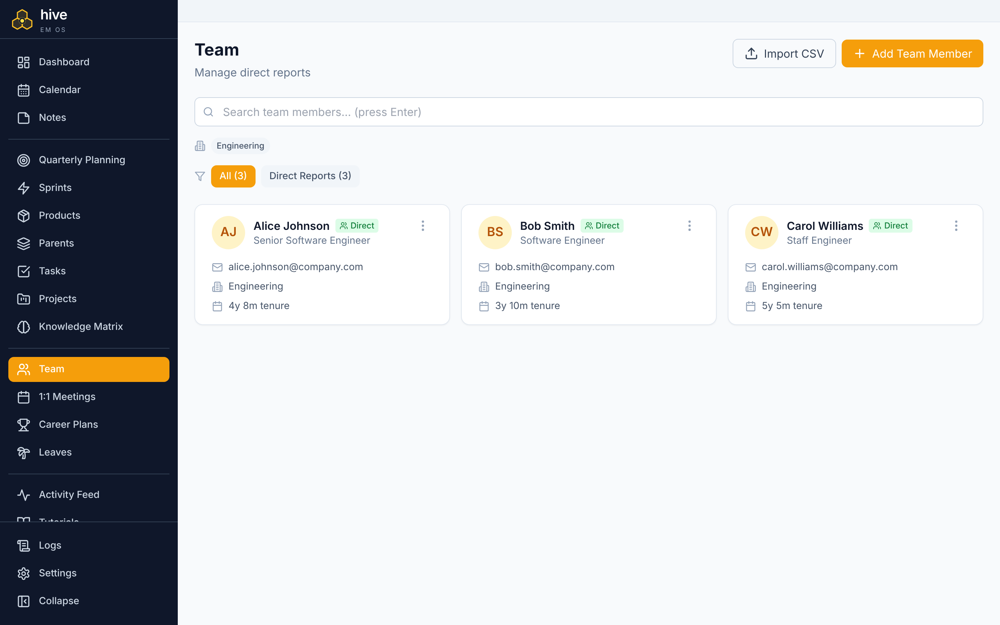
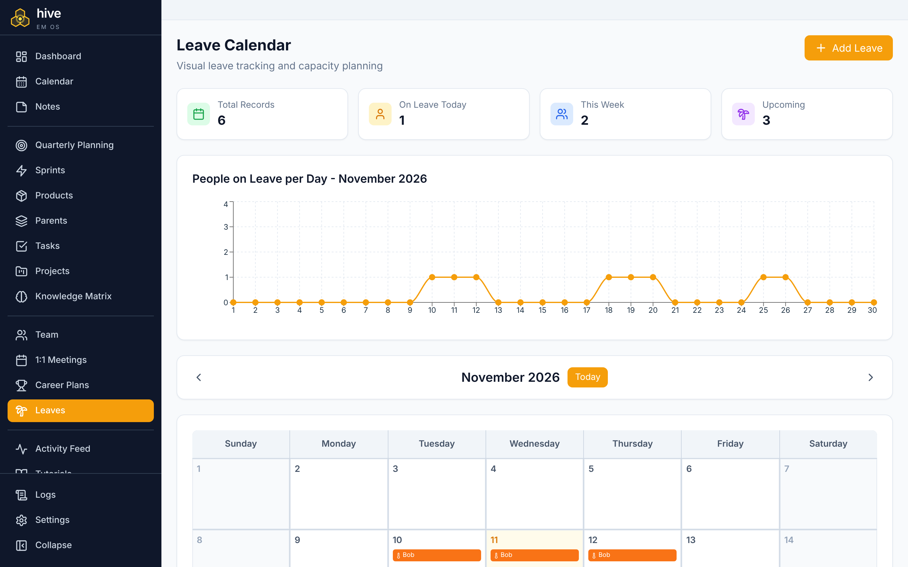

# Hive

[](https://github.com/MichaelGeranis/hive/actions/workflows/ci.yml)
[](https://github.com/MichaelGeranis/hive/releases)
[](LICENSE)

**The Engineering Manager's operating system.** A local-first desktop app for
people, delivery and planning, for macOS, Windows and Linux.



An EM's work is scattered across half a dozen tools that do not talk to each other:
reviews in an HR system, 1:1 notes in a personal doc, delivery data in Jira, capacity in a
spreadsheet, quarterly plans in slides. The manager becomes the integration layer, and the
questions that actually matter take an afternoon to answer.

Hive puts people, delivery and planning in one local desktop application, and
derives the answers instead of making you assemble them.

```
People ──┐
Delivery ─┼──> Capacity · Velocity · Knowledge risk · Planning insights · Sentiment
Planning ─┘
```

| Team | Leave and capacity |
|---|---|
|  |  |

## What it does

- **People:** direct reports, 1:1 notes with due dates, career plans built from
  skill roadmaps, a knowledge matrix that shows where the team is one person deep.
- **Delivery:** sprints, tasks and products, synced read-only from Jira, with
  velocity and product breakdowns.
- **Planning:** quarterly planning with capacity after leave and public holidays,
  a work-type mix, and a Plan-Catalogue spreadsheet export.
- **Insights:** a dashboard of what needs your attention today, plus optional AI
  summaries (sentiment, task readiness, retro summaries) from a local model
  through Ollama, or Claude.
- **Private by design:** everything lives in a SQLite file on your machine. No
  account, no server, no telemetry.

## Download

Installers for macOS (Apple silicon), Windows and Linux are attached to each
[release](https://github.com/MichaelGeranis/hive/releases). The builds are not
code-signed yet:

- **macOS:** right-click Hive in Applications and choose **Open** the first time.
- **Windows:** choose **More info → Run anyway** in SmartScreen.
- **Linux:** `chmod +x Hive-*.AppImage`, then run it, or install the `.deb`.

Your data is stored in `~/Library/Application Support/Hive` (macOS),
`%APPDATA%\Hive` (Windows) or `~/.local/share/Hive` (Linux). Hive starts with a
few sample team members you can delete.

---

## Documentation

| Document | What's in it |
|----------|--------------|
| [BUSINESS.md](BUSINESS.md) | Domain model, business rules, glossary, ubiquitous language |
| [ARCHITECTURE.md](ARCHITECTURE.md) | Layers, dependency rule, data model, state machine, extension recipes |
| [CODEBASE.md](CODEBASE.md) | File-by-file map of the repository |
| [CLAUDE.md](CLAUDE.md) | Working agreement for AI agents and contributors |
| [docs/DEBUGGING.md](docs/DEBUGGING.md) | IDE and browser debugging setups |

---

## Tech Stack

| Layer | Technology | Version |
|-------|-----------|---------|
| Backend API | ASP.NET Core (C#) | .NET 11 |
| Desktop shell | Electron | 45 |
| Frontend | React + TypeScript + Vite | React 19 |
| Styling | Tailwind CSS | 4.x |
| Database | SQLite + Entity Framework Core | EF Core 11 |
| Charts | Recharts | 3.x |
| AI (optional) | A local model through Ollama, or the Claude API via the official Anthropic C# SDK | Ollama 0.5+ / SDK 13.x |
| Backend testing | xUnit + Moq + FluentAssertions | xUnit 2.9 |
| Frontend testing | Vitest + Testing Library + MSW | Vitest 5.x |

---

## Prerequisites

- [.NET 11 SDK](https://dotnet.microsoft.com/download/dotnet/11.0)
- [Node.js 26](https://nodejs.org/) (the version CI uses)

All projects target `net11.0`. `global.json` asks for SDK 11.0.100 or a later
11.0 feature band.

---

## Getting Started

### 1. Clone and install

```bash
git clone https://github.com/MichaelGeranis/hive.git
cd hive
make install
```

`make install` restores NuGet packages and installs frontend dependencies.

### 2. Run it

```bash
make dev
```

This starts the backend on `http://localhost:5002` and the frontend on
`http://localhost:5173`.

To run the halves separately:

```bash
make backend-inmemory   # backend, in-memory database, resets on restart
make backend-sqlite     # backend, persistent SQLite database
make frontend           # Vite dev server only
```

**The backend must be running before the frontend is useful.** If port 5002 is already
held, `make kill-backend` frees it.

### 3. Sign in

All endpoints require HTTP Basic Authentication. The default credentials are
`admin` / `admin123` — a local-development convenience compiled into `AdminCredentials`,
not a secret. Override them with `HIVE_ADMIN_USERNAME` / `HIVE_ADMIN_PASSWORD` before
running the API anywhere but localhost; see [Configuration](#configuration).

### 4. Explore the API

With the backend running in development, Swagger UI is at `http://localhost:5002`.

### 5. Run the tests

```bash
make test               # backend + frontend
make test-coverage      # with coverage collection
make coverage-report    # generate and open the HTML report
```

---

## Common Commands

Run `make help` for the full list.

| Command | Does |
|---------|------|
| `make install` | Install backend and frontend dependencies |
| `make dev` | Run backend and frontend together |
| `make backend-sqlite` | Run backend with a persistent database |
| `make backend-inmemory` | Run backend with an in-memory database |
| `make frontend` | Run the Vite dev server (port 5173) |
| `make test` | Run all tests |
| `make test-coverage` | Run tests with coverage |
| `make coverage-report` | Generate and open the HTML coverage report |
| `make build` | Build backend and frontend |
| `make check` | Build and test |
| `make clean` | Remove build artifacts |
| `make kill-backend` | Free port 5002 |
| `make migration-add` | Create a new EF Core migration (prompts for a name) |
| `make migration-update` | Apply migrations to the database |
| `make migration-list` | List all migrations |
| `make migration-remove` | Remove the last migration |
| `make electron-build` | Build the packaged desktop application |

Direct equivalents:

```bash
dotnet build Hive.sln
dotnet run --project src/Hive.Api
dotnet test Hive.sln
dotnet test --filter "FullyQualifiedName~DirectReport"

cd src/Hive.Desktop
npm run electron:dev        # Vite + Electron together
npm run test                # Vitest
npm run electron:build      # Package the desktop app
```

---

## Database

Hive runs against one of two persistence modes, chosen by `UseInMemoryDatabase` in
`appsettings.json`. Unset, it defaults to in-memory in the Development environment.

| | In-memory | SQLite |
|---|---|---|
| Setting | `UseInMemoryDatabase: true` | `UseInMemoryDatabase: false` |
| Survives restart | No | Yes |
| Seeds data | Optional | On first run |
| Use for | Development, tests | Production, anything you want to keep |

The SQLite file lives in a platform-specific user data directory:

| Platform | Path |
|----------|------|
| macOS | `~/Library/Application Support/Hive/hive.db` |
| Windows | `%APPDATA%/Hive/hive.db` |
| Linux | `~/.local/share/Hive/hive.db` |

`HIVE_DATABASE_PATH` overrides all three.

> **Note for contributors:** these are two genuinely separate implementations, not one
> store with two backends. Every repository interface is implemented twice. See
> [ARCHITECTURE.md § Dual Persistence](ARCHITECTURE.md#dual-persistence) before adding an
> entity.

---

## Contributing

Contributions are welcome. Read [CONTRIBUTING.md](CONTRIBUTING.md) first. This
project follows a [Code of Conduct](CODE_OF_CONDUCT.md). To report a security
problem, see [SECURITY.md](SECURITY.md); please do not open a public issue.

### Development workflow

1. Create a branch: `git checkout -b feat/your-feature`.
2. Read [ARCHITECTURE.md](ARCHITECTURE.md) if you are adding an entity, a page, or a
   dashboard widget — each has a recipe, and each has a step that is easy to miss.
3. Make your changes. Domain rules go on the entity, not in a service.
4. Run `make test`. Add tests for what you changed.
5. Update [CODEBASE.md](CODEBASE.md) if you added or removed a file.
6. Commit using [conventional commits](https://www.conventionalcommits.org/):
   `feat:`, `fix:`, `docs:`, `refactor:`, `test:`, `chore:`.
7. Open a pull request against `main`.

### Before you open a PR

- Both repository implementations registered, if you added one
- DTOs cover every field the frontend needs — controllers never return entities
- Tests added for entity, repository, service, and controller
- Docs updated: CODEBASE.md for files, ARCHITECTURE.md for structure, BUSINESS.md for rules

Full checklist in [CLAUDE.md](CLAUDE.md).

---

## Configuration

### Environment variables

| Variable | Description |
|----------|-------------|
| `HIVE_DATABASE_PATH` | Override the default SQLite database location |
| `HIVE_ADMIN_USERNAME` / `HIVE_ADMIN_PASSWORD` | Override the Basic Auth credentials (backend). The standard `AdminCredentials__Username` / `AdminCredentials__Password` variables work too |
| `VITE_ADMIN_USERNAME` / `VITE_ADMIN_PASSWORD` | Credentials the desktop client is built with — set them to match the backend. See `src/Hive.Desktop/.env.example` |
| `ASPNETCORE_ENVIRONMENT` | `Development` enables Swagger and defaults to the in-memory database |

### appsettings.json

| Key | Description |
|-----|-------------|
| `AdminCredentials:Username` | Basic Auth username. Absent by default — the `admin` default lives in code, and the environment variables above are the preferred override |
| `AdminCredentials:Password` | Basic Auth password. Absent by default, as above |
| `UseInMemoryDatabase` | `true` for in-memory, `false` for SQLite |

### Runtime settings

Everything the manager can change while the app is running is stored in the database and
edited on the Settings page, not in a config file: T-shirt size mappings, dashboard warning
thresholds, the 1:1 cadence, maintenance labels, the epic names of the work categories, the Jira base URL, the optional Jira Cloud API
credentials, the optional Google Calendar address, and the sentiment model: a local Ollama
address and model, or the optional Claude API key.

### Frontend

The API base URL is set in `src/Hive.Desktop/src/services/api.ts`
(`http://localhost:5002/api`). CORS on the backend allows exactly one origin,
`http://localhost:5173`.

Credentials are read at build time from `VITE_ADMIN_USERNAME` / `VITE_ADMIN_PASSWORD`,
falling back to the same `admin` / `admin123` default. Copy
`src/Hive.Desktop/.env.example` to `.env.local` to override them — local `.env` files are
gitignored, so a real credential never gets committed.

---

## Optional: sentiment analysis

Hive can analyse the tone of your 1:1 notes with an AI model. It is **off by default**; turn
it on in Settings under AI analysis, and choose the model:

- **Local (Ollama)**, the default. The notes never leave your machine. Install
  [Ollama](https://ollama.com/download), run `ollama pull llama3.1:8b`, and press **Test
  connection**. The address (`http://localhost:11434`) and the model can be changed. A local
  model takes from seconds to a few minutes per person, depending on the machine.
- **Claude API**, with your own API key. Its judgement is better, but the notes are sent to
  Anthropic.

Both are asked exactly the same question. See
[BUSINESS.md § Sentiment insights](BUSINESS.md#sentiment-insights).

## Optional: task readiness

Hive can check the work you are about to build before the team starts it. The **Task
readiness** tile, first under Delivery on the Dashboard, lists the unstarted stories, tasks and
bugs of the current and next sprint. Hive flags any story or task whose description has no
acceptance criteria by itself, with no AI, and raises it in Needs attention. Turn on
**Enable Task Review** in Settings under AI analysis, and the same model as sentiment analysis
also reviews each task's title and description while the Dashboard is open: whether it is ready,
and what is missing. Reviewed tasks carry an AI bee badge, on the Dashboard and on the Tasks
page. Task descriptions are synced from Jira whole, as Markdown. See
[BUSINESS.md § Task readiness](BUSINESS.md#task-readiness).

## Optional: retro summary

Hive can summarise your team's retrospectives on the Dashboard, under Team health: warnings
first, then a summary, the action items the team agreed and suggestions for what to do next.
It is **off by default**. Create a folder named **Retro** in Notes and write one note per
retro, titled by its date (e.g. `2026-09-28`). Then turn it on in Settings under AI analysis,
where you also choose how many of the latest retros it reads (6 by default). It uses the same
model as sentiment analysis, and makes the summary again whenever a retro changes. See
[BUSINESS.md § Retro summary](BUSINESS.md#retro-summary).

---

## Optional: Jira sync

Hive can pull from Jira Cloud so you do not have to export CSVs: upcoming sprints and sprint start and end
dates from a board, a product for every component in a space, a parent for every epic (and
every other issue with sub-tasks) in that space, and every task in the team's sprints.
Products, parents and tasks mirror Jira: what Jira no longer returns is removed. On the
Settings page, under
Jira Integration, set the Jira base URL, your Atlassian account email, an
[API token](https://id.atlassian.com/manage-profile/security/api-tokens), the board ID
(the number in the board's URL) for sprint dates, and the space key (e.g. `MAR`) for products, parents and tasks. Classic and scoped API tokens both work; a scoped token
needs read access to Jira Software boards and sprints, and to the space's work items and components. Then press **Sync Jira** on the Dashboard to pull everything, or
the **Sync Jira** button on the Sprints, Products, Parents or Tasks page to pull just that. Hive only reads
from Jira. See [BUSINESS.md § Jira sync](BUSINESS.md#jira-sync).

---

## Optional: Google Calendar

Hive can show your Google Calendar events on the Daily Planner, with no Google sign-in and no
API key. In Google Calendar open **Settings**, pick your calendar, and under **Integrate
calendar** copy the **Secret address in iCal format**. Paste it on Hive's Settings page under
Google Calendar. On the Daily Planner, press **Sync Google Calendar** to load your events;
a sync is reused for 30 minutes, so returning to the page or syncing again within that time is
instant. Hive never writes to your calendar. Treat the address like a password; if it leaks, reset it in Google Calendar. Some
Google Workspace admins turn the secret address off. See
[ARCHITECTURE.md § Google Calendar Integration](ARCHITECTURE.md#google-calendar-integration).

---

## Security note

Hive is a **single-user, local-first desktop application**.

- **The API** listens on localhost and answers only loopback host names, so a web page cannot
  reach it, even by pointing its own domain at your machine. The desktop app gives it a new
  random password on every launch; the public `admin` / `admin123` default works only when
  running from source in Development, and the backend refuses to start with it otherwise.
- **Your data is encrypted** in the desktop app: the database, its automatic backups, and the
  Claude key, Jira token and Google Calendar address in it, with a key kept in your operating
  system's keychain. Copying `hive.db` to another machine or account gives nothing readable.
  If that keychain entry is lost, so is the data: keep an **Export Backup** (Settings), which
  is plain JSON, somewhere safe. Running from source, the database is not encrypted.
- **Links** in notes and Jira data open in your browser only if they are web or mail links.

Do not deploy Hive to a shared host without replacing the authentication scheme first — see
[ARCHITECTURE.md § Authentication](ARCHITECTURE.md#authentication).

---

## License

Licensed under the [Apache License 2.0](LICENSE). Third-party packages keep
their own licences.
